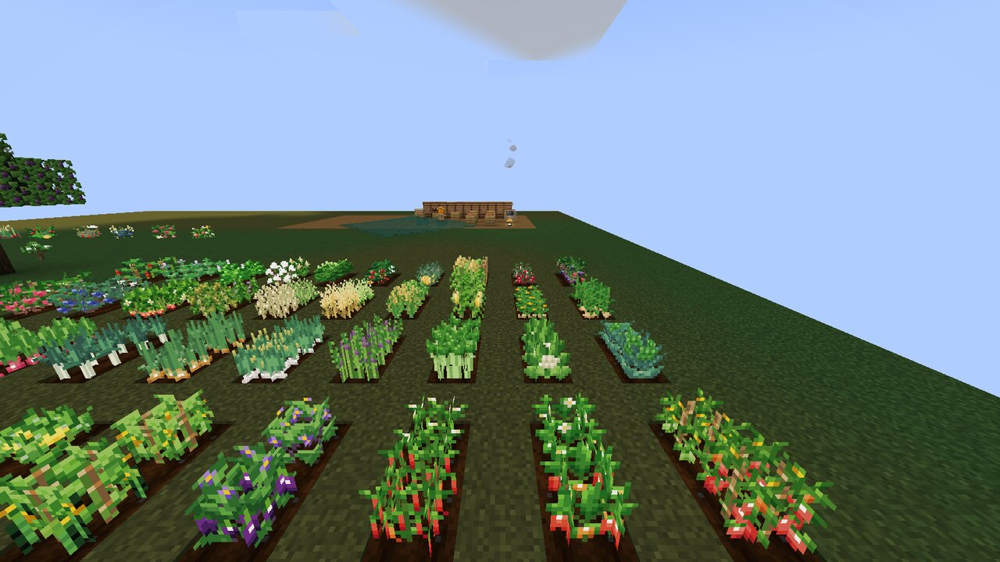
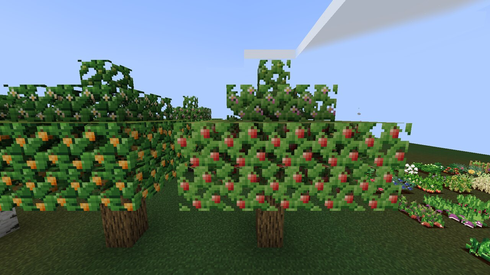
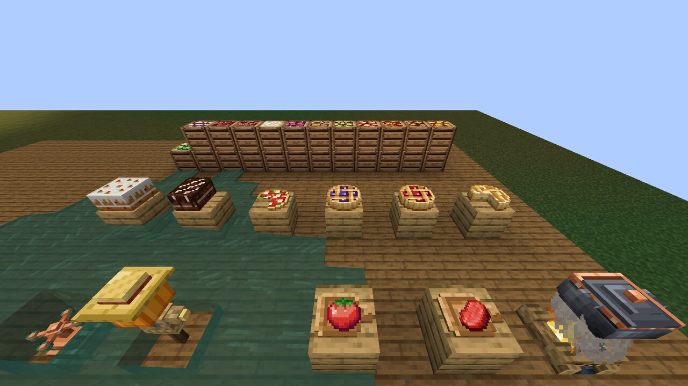
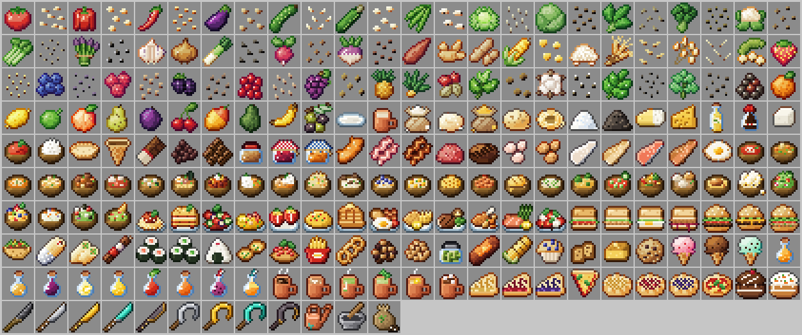

# Sprout & Soil

**The all-in-one farming and cooking mod for Minecraft.** Grow 40 crops and 12 fruit trees, forage wild
gardens, water your fields, cook more than 100 dishes in a real kitchen, and eat well.

Sprout & Soil 1.0 is a ground-up rewrite: new code, new content, and a fully generated, hand-tuned
pixel-art asset set. It runs on **Fabric** and **NeoForge** for **Minecraft 1.21.1** (more versions will
follow from the same codebase).



| Orchard | Kitchen |
| --- | --- |
|  |  |



*Screenshots are captured from the real game client by `tools/showcase/capture.sh`.*

## Features

### Farming
- **40 crops** with four growth stages each, built on vanilla crop mechanics (bone meal, bees, villagers,
  farmland) so they work with any farming add-on.
  - Vegetables: tomato, bell pepper, chili, eggplant, cucumber, zucchini, green beans, lettuce, cabbage,
    spinach, broccoli, cauliflower, celery, asparagus, onion, leek, radish, turnip, sweet potato
  - Grains & legumes: corn (grows two blocks tall), rice, barley, oats, soybeans, peanuts
  - Berries & fruit: strawberry, blueberry, raspberry, blackberry, cranberry, grapes, pineapple
  - Herbs, spices & cash crops: garlic, ginger, basil, mint, peppercorns, coffee, tea, cotton
- **Right-click harvesting** that replants automatically (also for vanilla wheat, carrots, potatoes and beetroot).
- **Perennials**: berries, peppers, tomatoes, herbs, coffee and tea regrow after picking instead of being replanted.
- **12 fruit trees** — apple, orange, lemon, lime, peach, pear, plum, sweet cherry, mango, avocado, banana and
  olive. Leaves blossom, set fruit and ripen; right-click ripe leaves to pick. Trees grow naturally in fitting
  biomes and from saplings.
- **Wild gardens** in six climates (meadow, woodland, highland, arid, tropical, marsh) drop the seeds that grow there.
- **Watering can** — hold to water a 3×3 patch: hydrates farmland and gives growth bursts. Refill at any water.
- **Sprinkler** — place next to water to hydrate and boost a 9×9 field automatically.
- **Sickles** (iron, gold, diamond, netherite) harvest and replant 3×3 or 5×5 areas; Fortune works.
- **Fertilizer** — bone meal for a whole 5×5 patch.
- **Scarecrow** — farmland within 8 blocks can no longer be trampled.
- **Produce crates** for 23 crops and fruits, perfect for storage and decoration.

### Kitchen
- **Cooking pot** — up to six ingredients plus a serving container (bowl, plate, mug, bottle). Needs heat below
  (lit campfire, fire, magma, lava). Hopper-friendly: ingredients from the top, containers from the sides, dishes
  from the bottom. Pays out experience like a furnace.
- **Cutting board + knives** (flint, iron, gold, diamond, netherite) — slice meat into bacon, mince, cuts and fish
  fillets, pumpkins into wedges, melons into slices.
- **Mortar & pestle** — grinds flour, cornmeal, spices and oils right in the crafting grid, losing durability
  instead of being consumed.
- **100+ foods**: soups and stews, curries, ramen, risotto, pasta, lasagna, paella, sandwiches, burgers, tacos,
  burritos, sushi, salads, juices, smoothies, coffee, teas and hot cocoa, ice cream, muffins, cookies — plus
  placeable **pies, pizza and cakes** that are shared slice by slice.
- **Meaningful meals**: hearty dishes grant **Well Fed** (hunger drains slowly), hot drinks grant **Cozy**
  (no freezing, gentle healing) and coffee makes you **Caffeinated** (faster movement and mining).

### World & compatibility
- Farmer villagers trade seeds, produce, fruit, meals and tools; wandering traders sell saplings.
- Convention tags (`c:crops/*`, `c:seeds/*`, `c:foods/*`, `c:tools/knife`, `c:drinks`) for cross-mod recipes.
- Compostable produce, villager-plantable seeds, bee pollination, Fortune and Silk Touch support.
- **JEI** integration for cooking pot and cutting board recipes (also picked up by EMI/REI JEI compat layers).
- Advancement tree with 18 goals, from your first seed to *Master Gardener* and *Gourmet*.

## Supported versions

| Workspace | Minecraft | Loaders | Java |
| --- | --- | --- | --- |
| `1.21.1/` | 1.21.1 | Fabric (Loader ≥ 0.16, Fabric API), NeoForge ≥ 21.1.80 | 21 |

> **1.0 is a breaking update.** Blocks and items from 0.x (`*_plant_stage_*`, `letuce`) no longer exist;
> start a new world or expect those blocks to disappear.

## Building

```bash
cd 1.21.1
./gradlew build                 # jars in fabric/build/libs and neoforge/build/libs
```

From the repository root, `./gradlew buildAll` builds every workspace and collects the jars in `all-jars/`.

## Testing

```bash
cd 1.21.1
./gradlew :fabric:runGametest              # in-world GameTests (crops, harvesting, cooking pot, cutting board,
./gradlew :neoforge:runGameTestServer      #  mortar, fruit picking, pies, sprinkler, registration)
cd .. && tools/smoke_server.sh fabric      # boots a dedicated server on a fresh world and fails on any
tools/smoke_server.sh neoforge             #  recipe / loot / tag / worldgen error
tools/showcase/capture.sh /tmp/shots       # real client on a virtual display (Xvfb), screenshots a showcase
```

## Project layout

```
1.21.1/                    MultiLoader workspace (common + fabric + neoforge)
  common/src/main          hand-written code and resources
  common/src/generated     generated assets & data (do not edit by hand)
tools/assetgen/            content spec + asset pipeline (Python 3 + Pillow)
  sas/spec/                ← every crop, tree, dish and recipe is declared here, once
  sas/art/                 pixel-art and 3D-model generators
  sas/datagen.py           models, blockstates, recipes, loot, tags, worldgen, advancements, lang
  STYLE.md                 art style guide
tools/smoke_server.sh      boots a dedicated server per loader and checks the logs
tools/showcase/            datapack-driven in-game showcase + screenshot capture
```

The Java side reads `sprout_and_soil/content/manifest.json` (generated from the spec) to register the
data-driven content, so ids, textures, recipes and translations can never drift apart.

```bash
python3 tools/assetgen/build_assets.py          # regenerate data, models and lang; validate
python3 tools/assetgen/build_assets.py --art    # also regenerate every texture and 3D model
```

## Publishing (local)

```bash
./gradlew buildAll
node scripts/upload_platforms.mjs --version 1.0.0
```

Requires `MODRINTH_TOKEN`, `CURSEFORGE_TOKEN`, and `CURSEFORGE_API_KEY`.

## Contributing / Security / License

- [CONTRIBUTING.md](CONTRIBUTING.md)
- [SECURITY.md](.github/SECURITY.md)
- Licensed under the [Apache License 2.0](LICENSE); all textures and models are original works generated by
  the code in `tools/assetgen`.
