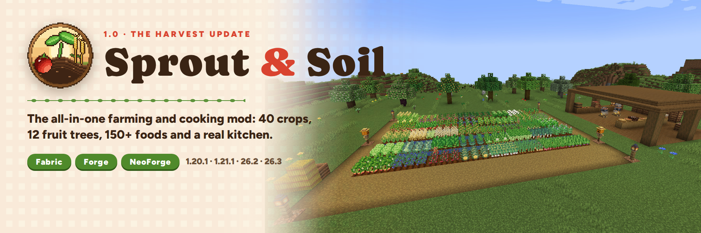
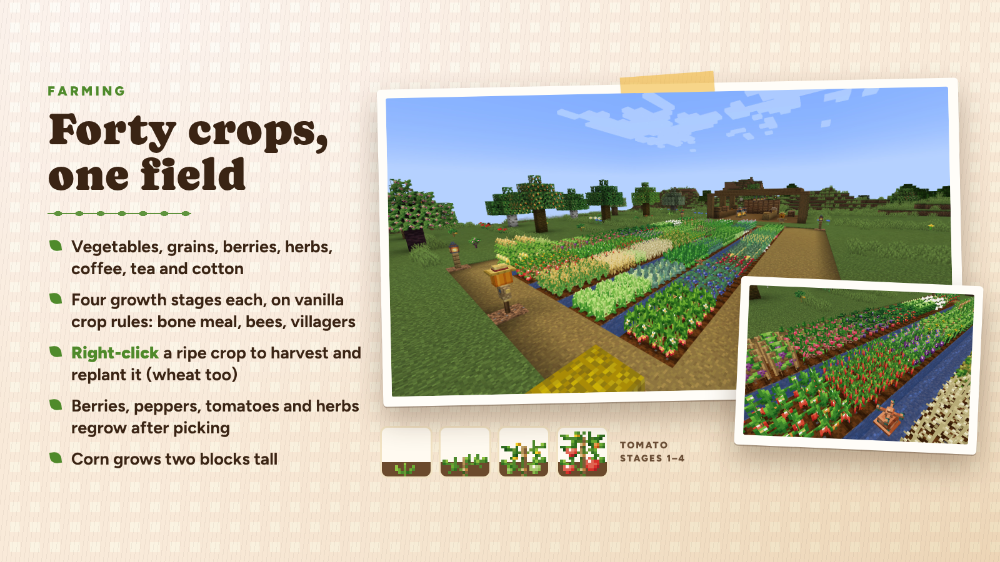
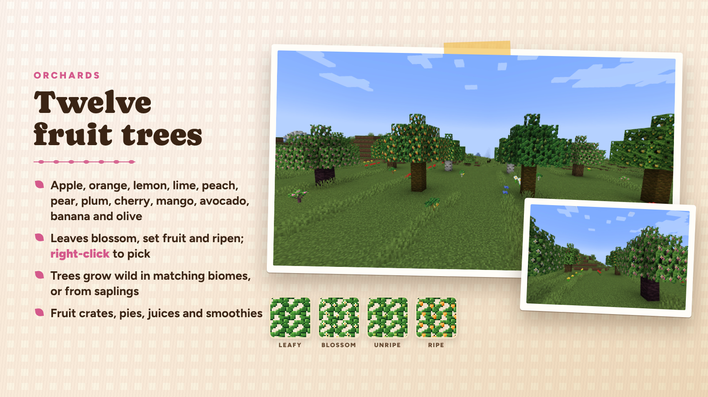
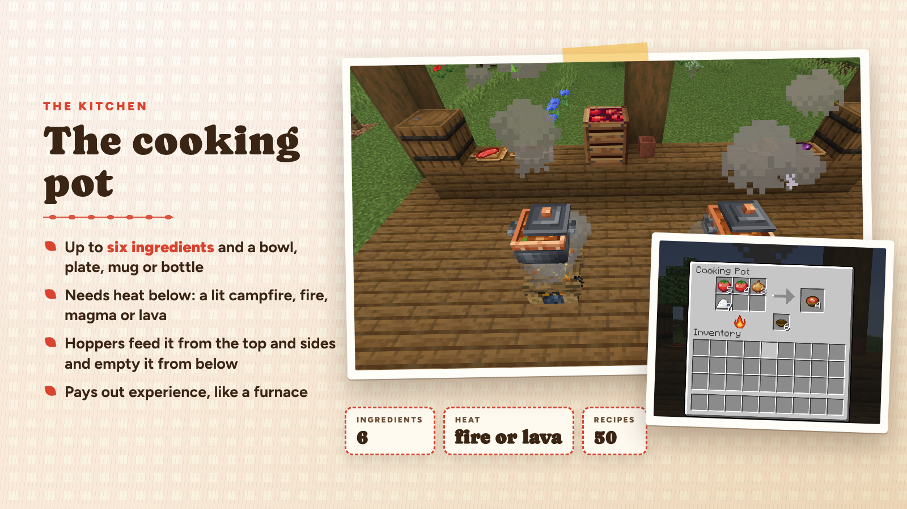
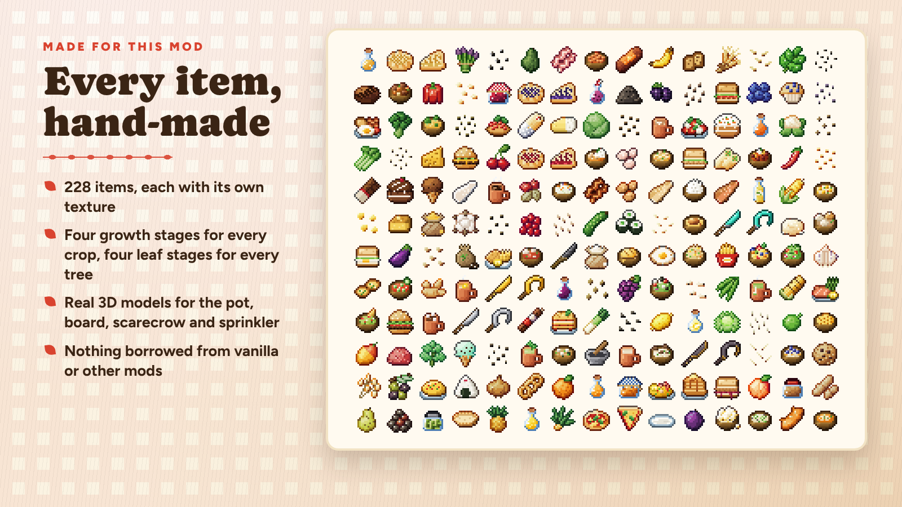

# Sprout & Soil

**The all-in-one farming and cooking mod for Minecraft.** Grow 40 crops and 12 fruit trees, forage wild
gardens, water your fields, cook more than 100 dishes in a real kitchen, and eat well.

Sprout & Soil 1.0 is a ground-up rewrite: new code, new content, and a fully generated, hand-tuned
pixel-art asset set. It runs on **Minecraft 1.20.1** (**Fabric** and **Forge**) and on **Minecraft 1.21.1, 26.2
and 26.3** (**Fabric** and **NeoForge**), with the same crops, trees, foods and blocks everywhere.



| Orchards | Kitchen |
| --- | --- |
|  |  |



*Screenshots are single frames from the real game client, captured by `marketing/source/capture.py`; the listing
copy and artwork live in [`marketing/`](marketing/README.md).*

## Features

### Farming
- **40 crops** with four growth stages each, built on vanilla crop mechanics (bone meal, bees, villagers,
  farmland) so they work with any farming add-on.
  - Vegetables: tomato, bell pepper, chili, eggplant, cucumber, zucchini, green beans, lettuce, cabbage,
    spinach, broccoli, cauliflower, celery, asparagus, onion, leek, radish, turnip, sweet potato
  - Grains & legumes: corn (grows two blocks tall), rice, barley, oats, soybeans, peanuts
  - Berries & fruit: strawberry, blueberry, raspberry, blackberry, cranberry, grapes, pineapple
  - Herbs, spices & cash crops: garlic, ginger, basil, mint, peppercorns, coffee, tea, cotton
- **Right-click harvesting** that replants automatically (also for vanilla wheat, carrots, potatoes and beetroot).
- **Perennials**: berries, peppers, tomatoes, herbs, coffee and tea regrow after picking instead of being replanted.
- **12 fruit trees** — apple, orange, lemon, lime, peach, pear, plum, sweet cherry, mango, avocado, banana and
  olive. Leaves blossom, set fruit and ripen; right-click ripe leaves to pick. Trees grow naturally in fitting
  biomes and from saplings.
- **Wild gardens** in six climates (meadow, woodland, highland, arid, tropical, marsh) drop the seeds that grow there.
- **Watering can** — hold to water a 3×3 patch: hydrates farmland and gives growth bursts. Refill at any water.
- **Sprinkler** — place next to water to hydrate and boost a 9×9 field automatically.
- **Sickles** (iron, gold, diamond, netherite) harvest and replant 3×3 or 5×5 areas; Fortune works.
- **Fertilizer** — bone meal for a whole 5×5 patch.
- **Scarecrow** — farmland within 8 blocks can no longer be trampled.
- **Produce crates** for 23 crops and fruits, perfect for storage and decoration.

### Kitchen
- **Cooking pot** — up to six ingredients plus a serving container (bowl, plate, mug, bottle). Needs heat below
  (lit campfire, fire, magma, lava). Hopper-friendly: ingredients from the top, containers from the sides, dishes
  from the bottom. Pays out experience like a furnace.
- **Cutting board + knives** (flint, iron, gold, diamond, netherite) — slice meat into bacon, mince, cuts and fish
  fillets, pumpkins into wedges, melons into slices.
- **Mortar & pestle** — grinds flour, cornmeal, spices and oils right in the crafting grid, losing durability
  instead of being consumed.
- **100+ foods**: soups and stews, curries, ramen, risotto, pasta, lasagna, paella, sandwiches, burgers, tacos,
  burritos, sushi, salads, juices, smoothies, coffee, teas and hot cocoa, ice cream, muffins, cookies — plus
  placeable **pies, pizza and cakes** that are shared slice by slice.
- **Meaningful meals**: hearty dishes grant **Well Fed** (hunger drains slowly), hot drinks grant **Cozy**
  (no freezing, gentle healing) and coffee makes you **Caffeinated** (faster movement and mining).

### World & compatibility
- Farmer villagers trade seeds, produce, fruit, meals and tools; wandering traders sell saplings (1.20.1 and 1.21.1).
- Convention tags (`c:crops/*`, `c:seeds/*`, `c:foods/*`, `c:tools/knife`, `c:drinks`) for cross-mod recipes;
  on 1.20.1 also the Forge-style `forge:crops/*`, `forge:seeds/*`, `forge:vegetables`, `forge:tools/knives`.
- Compostable produce, villager-plantable seeds, bee pollination, Fortune and Silk Touch support.
- **JEI** integration for cooking pot and cutting board recipes (also picked up by EMI/REI JEI compat layers) on
  1.20.1 and 1.21.1.
- Advancement tree with 18 goals, from your first seed to *Master Gardener* and *Gourmet*.

## Supported versions

| Workspace | Minecraft | Loaders | Java |
| --- | --- | --- | --- |
| `1.20.1/` | 1.20.1 | Fabric (Loader ≥ 0.16, Fabric API), Forge ≥ 47.4.0 | 17 |
| `1.21.1/` | 1.21.1 | Fabric (Loader ≥ 0.16, Fabric API), NeoForge ≥ 21.1.80 | 21 |
| `26.2/` | 26.2 | Fabric (Loader ≥ 0.20.1, Fabric API), NeoForge ≥ 26.2.0.93 | 25 |
| `26.3/` | 26.3 | Fabric (Loader ≥ 0.20.1, Fabric API), NeoForge ≥ 26.3.0.97 | 25 |

On 26.2 and 26.3 there is no JEI integration and the mod adds no villager or wandering trader trades; the mortar
recipes are plain shapeless crafting recipes there. Everything else is the same on all four versions.

> **1.0 is a breaking update.** Blocks and items from 0.x (`*_plant_stage_*`, `letuce`) no longer exist;
> start a new world or expect those blocks to disappear.

## Building

Each Minecraft version is a separate MultiLoader Gradle workspace with its own wrapper. These are the only supported
targets (the NightBeam convention): 8 jars per release, all with the same version.

| Minecraft | Loaders | Java | Folder |
| --- | --- | --- | --- |
| 1.20.1 | Forge, Fabric | 17 bytecode (build on 21) | `1.20.1/{common,forge,fabric}` |
| 1.21.1 | NeoForge, Fabric | 21 | `1.21.1/{common,neoforge,fabric}` |
| 26.2 | NeoForge, Fabric | 25 | `26.2/{common,neoforge,fabric}` |
| 26.3 | NeoForge, Fabric | 25 | `26.3/{common,neoforge,fabric}` |

```bash
./gradlew buildAll             # every workspace, then the 8 loader jars into releases/
./gradlew build263             # one workspace (keys: 1201, 1211, 262, 263)
cd 1.20.1 && ./gradlew build   # Gradle on Java 21 (Java 17 toolchain)
cd 1.21.1 && ./gradlew build   # Java 21
cd 26.3 && ./gradlew build     # Java 25 (the same for 26.2)
```

The root build hands the 26.x workspaces `JAVA_HOME_25_X64` (or `-Pjava25Home=<jdk>`) and the others
`JAVA_HOME_21_X64` (or `-Pjava21Home=<jdk>`); without them each workspace uses the current `JAVA_HOME`.
Jars land in `<workspace>/<loader>/build/libs/sprout_and_soil-<loader>-<minecraft>-<version>.jar`. Every
workspace's `gradle.properties` carries the same `version=` as the root `VERSION` file (`./gradlew checkVersions`;
set it with `./gradlew syncVersion -PmodVersion=x.y.z`). `python3 scripts/check_targets.py workspaces` checks the
targets, the shared version and the metadata ranges. Release notes for a version live in `patchnotes/<version>.md`
and in [CHANGELOG.md](CHANGELOG.md).

## Testing

```bash
cd 1.21.1 && ./gradlew :fabric:runGametest :neoforge:runGameTestServer   # in-world GameTests (crops, harvesting,
cd 1.20.1 && ./gradlew :fabric:runGametest :forge:runGameTestServer      #  cooking pot, cutting board, mortar,
cd 26.3 && ./gradlew :fabric:runGametest :neoforge:runGameTestServer     #  fruit, pies, sprinkler, enchanting...;
                                                                         #  the same for 26.2)
tools/qa/prod_server.sh 1.20.1 forge      # boots the built release jar on a real dedicated server (downloads the
                                          #  loader / Fabric API) and fails on any mod, mixin or data error
tools/qa/client_boot.sh 1.20.1 forge      # dev client on a virtual display (Xvfb): loads a world full of the
                                          #  mod's blocks, screenshots it and checks the log for model errors
tools/showcase/capture.sh /tmp/shots      # real client tour of a showcase world, one screenshot per scene
```

## Project layout

```
1.20.1/                    MultiLoader workspace (common + fabric + forge), Java 17
1.21.1/                    MultiLoader workspace (common + fabric + neoforge), Java 21
26.2/, 26.3/               MultiLoader workspaces (common + fabric + neoforge), Java 25
  common/src/main          hand-written code and resources
  common/src/generated     generated assets & data (do not edit by hand)
tools/assetgen/            content spec + asset pipeline (Python 3 + Pillow)
  sas/spec/                ← every crop, tree, dish and recipe is declared here, once
  sas/art/                 pixel-art and 3D-model generators
  sas/datagen.py           models, blockstates, recipes, loot, tags, worldgen, advancements, lang (1.21.1)
  sas/legacy.py            converts that output to the 1.20.1 data formats
  sas/modern.py            converts it to the 26.2 and 26.3 data formats
  STYLE.md                 art style guide
tools/qa/                  production server and client boot checks
tools/showcase/            datapack-driven in-game showcase + screenshot capture
scripts/                   release tooling: target checks, same-day guard, Modrinth / CurseForge upload
marketing/                 CurseForge / Modrinth listing copy and artwork
```

The Java side reads `sprout_and_soil/content/manifest.json` (generated from the spec) to register the
data-driven content, so ids, textures, recipes and translations can never drift apart. All four workspaces are
generated from the same spec, so every version ships the same content.

```bash
python3 tools/assetgen/build_assets.py          # regenerate data, models and lang; validate
python3 tools/assetgen/build_assets.py --art    # also regenerate every texture and 3D model
```

## Releasing

CI (`.github/workflows/ci.yml`) builds all 8 jars on every push to `main` that touches the build. Publishing to
Modrinth and CurseForge is `.github/workflows/publish.yml`, run by hand (`version`, `dry_run`) or by a `v*.*.*` tag;
it never runs on a plain push. It refuses a second release of the mod on the same day (Africa/Tunis), takes the jars
from `releases/`, the GitHub Release or a build from source, and fails unless exactly the 8 jars are found. It needs
the secrets `MODRINTH_TOKEN`, `CURSEFORGE_TOKEN`, `CURSEFORGE_API_KEY` and the variables `MODRINTH_ID`,
`CURSEFORGE_ID`.

## Contributing / Security / License

- [CONTRIBUTING.md](CONTRIBUTING.md)
- [SECURITY.md](.github/SECURITY.md)
- Licensed under the [Apache License 2.0](LICENSE); all textures and models are original works generated by
  the code in `tools/assetgen`.
