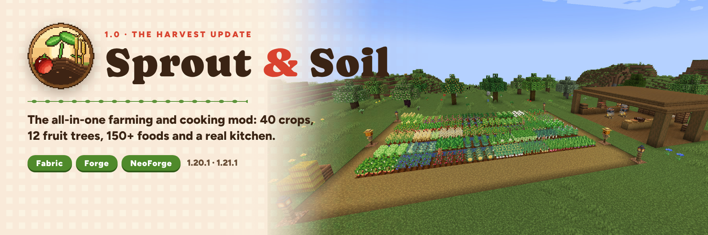

**The all-in-one farming and cooking mod.** Plant 40 crops and 12 fruit trees, forage wild gardens for new seeds,
keep your fields watered and safe, then carry the harvest to a real kitchen: a cooking pot over the fire, cutting
boards and knives, a mortar and pestle, and more than 150 foods and drinks to cook, bake, share and enjoy.

Everything is built on vanilla mechanics, so bone meal, bees, villagers, hoppers and other farming mods just work.
Every texture and model was made for this mod.

Fabric and Forge on Minecraft 1.20.1 · Fabric and NeoForge on Minecraft 1.21.1 · install on the server and clients ·
only Fabric API is needed on Fabric

- **40 crops**, from tomatoes and corn to coffee, tea and cotton, harvested with a right-click and replanted for you
- **12 fruit trees** whose leaves blossom, fruit and ripen, growing wild in matching biomes
- **A cooking pot** with up to six ingredients and a serving container, heated by a campfire, fire, magma or lava
- **Cutting boards, five knives and a mortar & pestle** to prepare ingredients
- **150+ foods and drinks**, including pies, pizza and cakes you place and share, and three new effects
- **Watering cans, sprinklers, sickles, fertilizer and scarecrows** to run a bigger farm
- **Wild gardens** in six climates, seeds from grass, and new farmer and wandering trader offers
- **23 produce crates**, an advancement tree, convention tags and JEI support

> **1.0 is a complete rewrite.** The 0.x blocks and items (`*_plant_stage_*`, `letuce`) no longer exist, so start a
> new world or expect them to disappear from an old one.

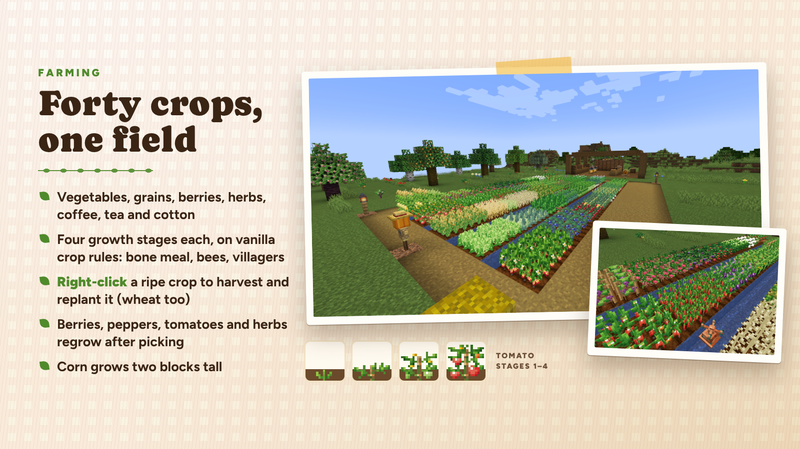

| Group | Crops |
|-------|-------|
| Vegetables | tomato, bell pepper, chili pepper, eggplant, cucumber, zucchini, green beans, lettuce, cabbage, spinach, broccoli, cauliflower, celery, asparagus, onion, leek, radish, turnip, sweet potato |
| Grains and legumes | corn, rice, barley, oats, soybeans, peanuts |
| Berries and fruit | strawberry, blueberry, raspberry, blackberry, cranberry, grapes, pineapple |
| Herbs, spices and more | garlic, ginger, basil, mint, peppercorns, coffee, tea, cotton |

- Every crop has four growth stages and uses the vanilla crop block: bone meal, bees, villagers and farmland work as
  you expect.
- **Right-click a ripe crop** to harvest it. One seed from the drops replants it, and Fortune counts. With an empty
  hand this works on wheat, carrots, potatoes, beetroots and modded crops built on the vanilla crop block too.
- **19 perennials** (berries, peppers, tomatoes, herbs, coffee, tea...) do not start over after picking: they drop back
  a few stages and fruit again.
- **Corn** grows two blocks tall and needs room above it.

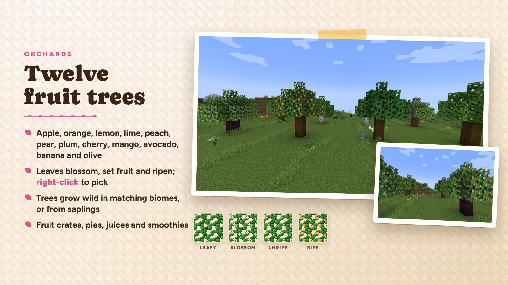

- Apple, orange, lemon, lime, peach, pear, plum, sweet cherry, mango, avocado, banana and olive.
- In daylight the leaves go from leafy to **blossoming**, set **unripe fruit** and then **ripen**. Right-click ripe
  leaves to pick one or two fruit; the cycle starts again.
- Trees grow wild in fitting biomes (orchards in forests and plains, citrus and tropical fruit in savannas and
  jungles, cherries in cherry groves, olives on dry plateaus) and from saplings you find, trade for or get from
  leaves.

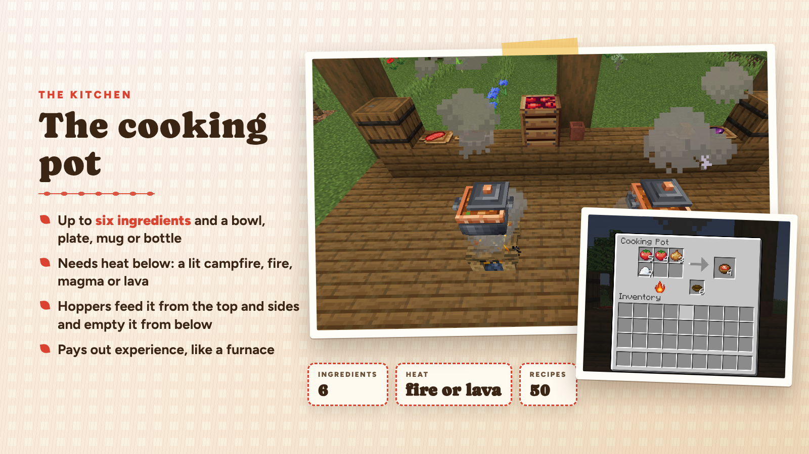

**The cooking pot** cooks up to six ingredients into a dish. Many dishes need a serving container (bowl, plate, mug
or glass bottle) in the container slot.

- It only cooks with **heat directly below**: a lit campfire or soul campfire, fire, a magma block, lava or a lava
  cauldron (the `#sprout_and_soil:heat_sources` block tag). The flame in its screen shows whether it is heated.
- **Hoppers** fill ingredients from the top and serving containers from the sides, and take the dishes (and empty
  buckets or bowls left behind) from the bottom. Comparators read how full it is.
- Finished dishes pay out **experience** when you take them, like a furnace. Progress cools down slowly if the heat or
  the ingredients go away.

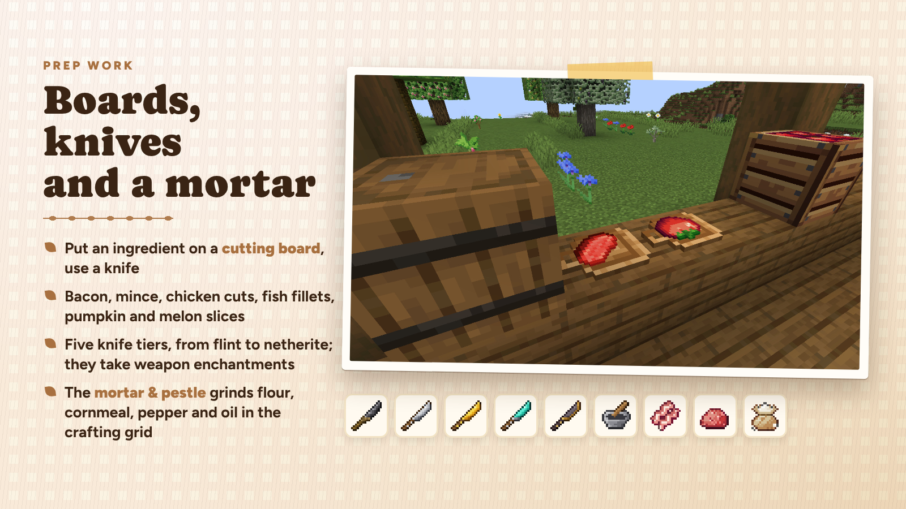

- Put an ingredient on a **cutting board** with a right-click, then use a **knife** on it: beef becomes mince,
  pork becomes bacon, chicken becomes cuts, fish become fillets, pumpkins and melons become slices.
- Knives come in flint, iron, gold, diamond and netherite (smithing upgrade). They are handy light weapons too and
  take weapon enchantments.
- The **mortar & pestle** stays in the crafting grid and loses durability instead of being used up. It grinds flour,
  cornmeal and black pepper, and presses cooking oil and peanut butter.

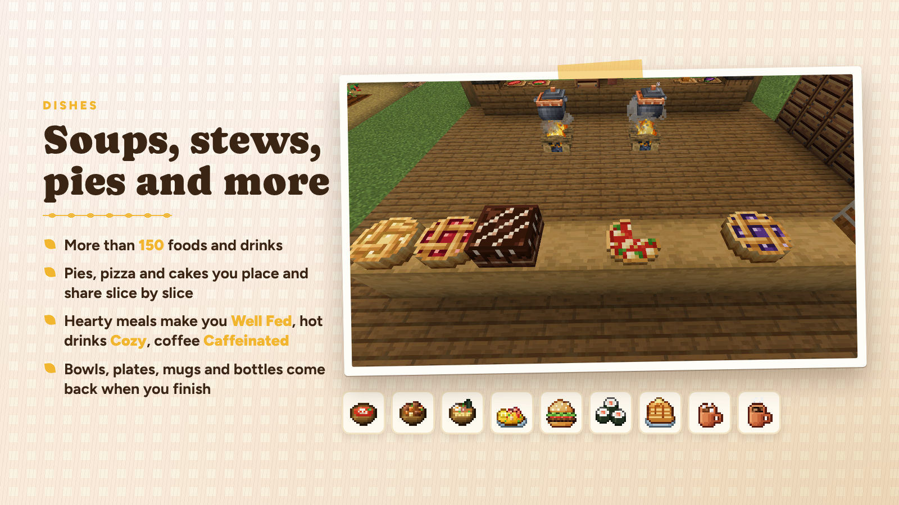

Soups and stews, curries, ramen, risotto, pasta, lasagna, paella, stir fries, burgers, tacos, burritos, sushi,
salads, sandwiches, breakfasts, juices, smoothies, coffee, teas, hot cocoa, ice cream, cookies, muffins and more.
Pies, pizza and cakes are **placed** and shared: each right-click serves a slice.

| Effect | From | What it does |
|--------|------|--------------|
| **Well Fed** | hearty meals | tops up your saturation every few seconds, so hunger drains far more slowly |
| **Cozy** | teas, café latte, hot cocoa | stops freezing in powder snow and heals you gently |
| **Caffeinated** | coffee, café latte | 15 % faster movement and mining |

Juices and smoothies add vanilla effects such as Speed, Haste, Regeneration, Jump Boost and Night Vision. Bowls,
plates, mugs and bottles come back when you finish a dish or drink.

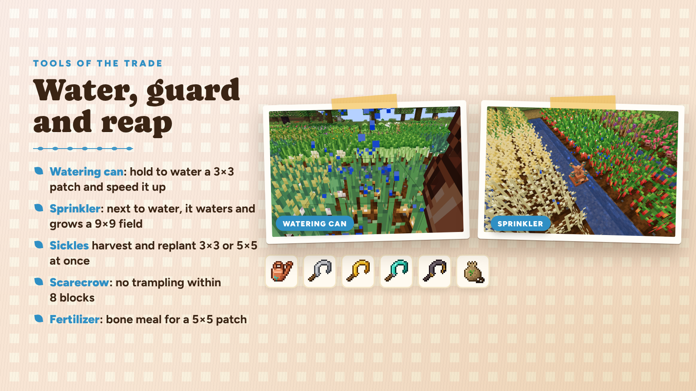

| Tool | What it does |
|------|--------------|
| **Watering can** | Hold use to water the 3×3 patch you look at: farmland is soaked, plants get extra growth and fires go out. Fill it at any water. |
| **Sprinkler** | Placed next to water (or a water cauldron, or above water), it soaks every farmland block in a 9×9 area and speeds up the plants there, every two seconds. |
| **Sickles** | Right-click a ripe crop to harvest and replant every ripe crop around it: 3×3 with iron or gold, 5×5 with diamond or netherite. Fortune counts. |
| **Scarecrow** | Farmland within 8 blocks can no longer be trampled (the fall still hurts). |
| **Fertilizer** | Bone meal for every plant in a 5×5 patch. |

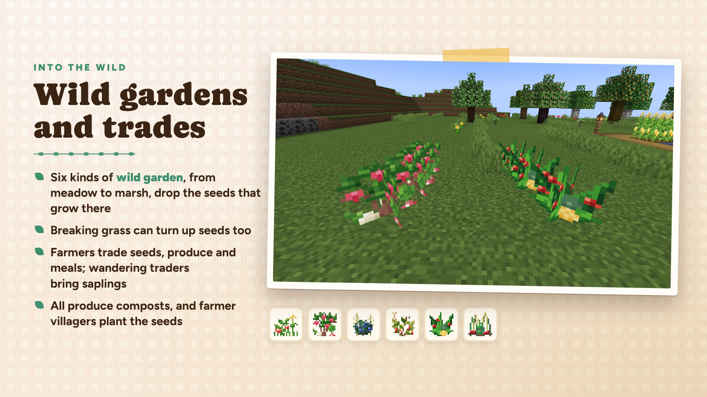

- **Wild gardens** grow in six climates (meadow, woodland, highland, arid, tropical and marsh). Break one for the
  seeds of the crops that grow there, or shear it to take it home.
- Breaking grass sometimes drops the seeds of temperate crops.
- **Farmers** trade seeds, produce, fruit, fertilizer, watering cans and meals. **Wandering traders** bring fruit
  saplings and rare seeds.
- Produce and seeds can be composted, and farmer villagers plant the seeds.

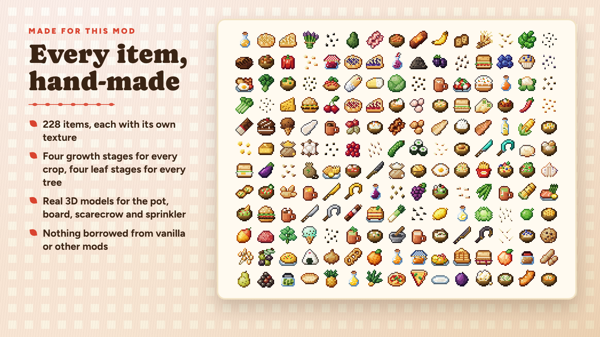

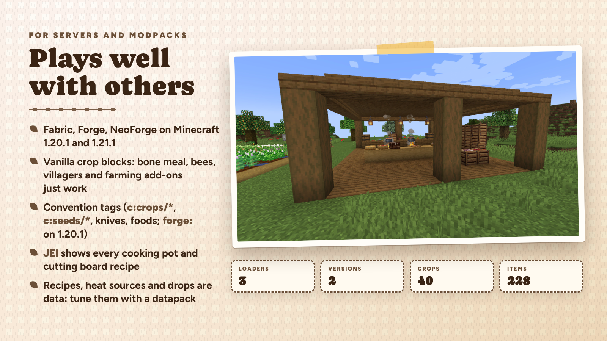

- **JEI** (optional) shows every cooking pot and cutting board recipe, with the pot and the board as catalysts.
- **Convention tags** so recipes from other mods accept our produce: `c:crops/*`, `c:seeds/*`, `c:foods/*`,
  `c:tools/knife` and `c:drinks`, plus `forge:crops/*`, `forge:seeds/*`, `forge:vegetables`, `forge:fruits` and
  `forge:tools/knives` on 1.20.1. Knives from other mods in those tags work on the cutting board.
- **Datapack friendly**: cooking pot (`sprout_and_soil:cooking`), cutting board (`sprout_and_soil:cutting`) and
  mortar (`sprout_and_soil:tool_shapeless`) recipes are JSON, and the heat sources, sickle blocks, knives and serving
  containers are tags.
- An **advancement tree** with 18 goals, from your first seed to *Master Gardener* and *Gourmet*.

Pick the file that matches **both** your Minecraft version and your loader:

| Minecraft | Fabric (needs Fabric API) | Forge / NeoForge |
|-----------|---------------------------|------------------|
| 1.20.1 | `sprout_and_soil-fabric-1.20.1-1.0.0.jar` | `sprout_and_soil-forge-1.20.1-1.0.0.jar` (Forge 47.4.0+) |
| 1.21.1 | `sprout_and_soil-fabric-1.21.1-1.0.0.jar` | `sprout_and_soil-neoforge-1.21.1-1.0.0.jar` (NeoForge 21.1.80+) |

Install it on the server and on every client. JEI is optional.

**Where do I get seeds?** Break wild gardens (they show up in most overworld biomes), break grass, or trade with
farmer villagers and wandering traders. Garlic, onions, sweet potatoes, ginger, peanuts, rice, soybeans, coffee
beans and peppercorns are planted directly, like potatoes.

**Why is my cooking pot not cooking?** It needs heat directly below it (see the flame in its screen) and, for many
dishes, the right container in the container slot. JEI shows exactly what each dish needs.

**Does it work with other farming and cooking mods?** Yes. Crops are vanilla crop blocks, so harvesting add-ons,
bone meal and villagers handle them, and the convention tags let other mods' recipes use our produce.

**Can I change the recipes?** Yes, every recipe is a JSON file you can override with a datapack, and the heat
sources, knives and serving containers are tags.

**Can I keep my 0.x world?** 1.0 is a rewrite: the old 0.x crop blocks and items are gone. Start a new world, or
expect them to disappear.

**Does it need to be on the client?** Yes, install it on both: the client needs the blocks, items, models and the
cooking pot screen.

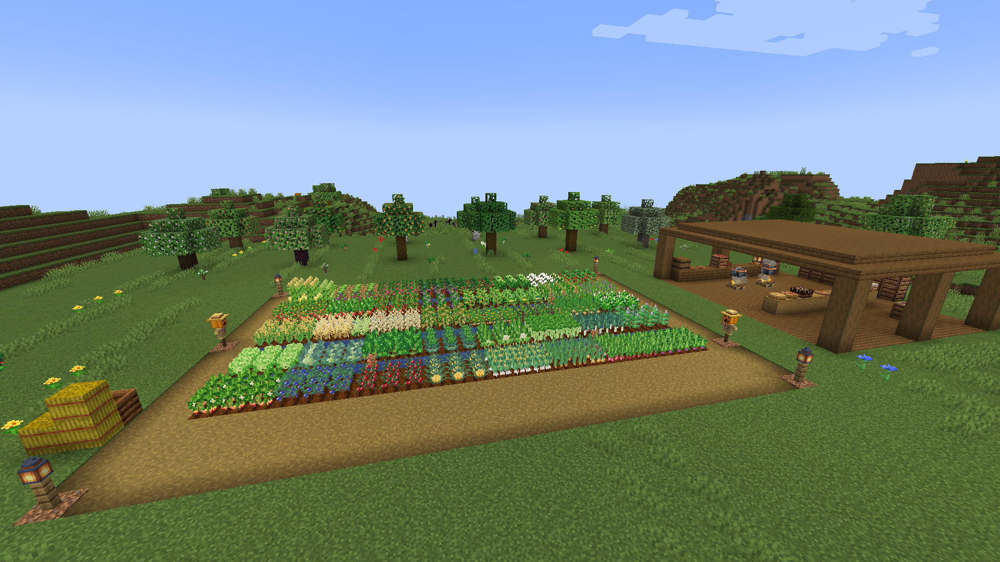

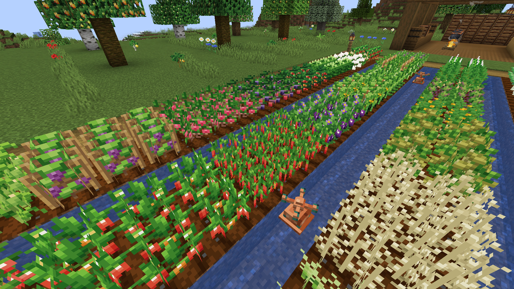

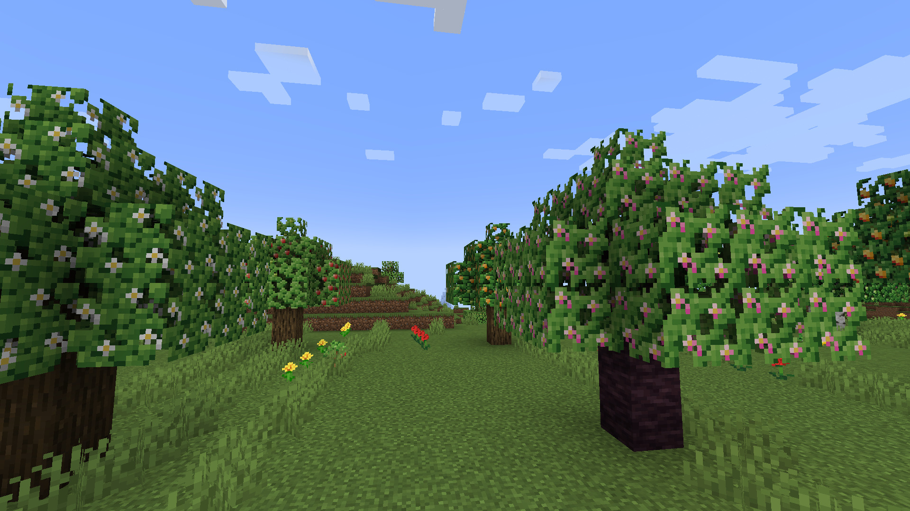

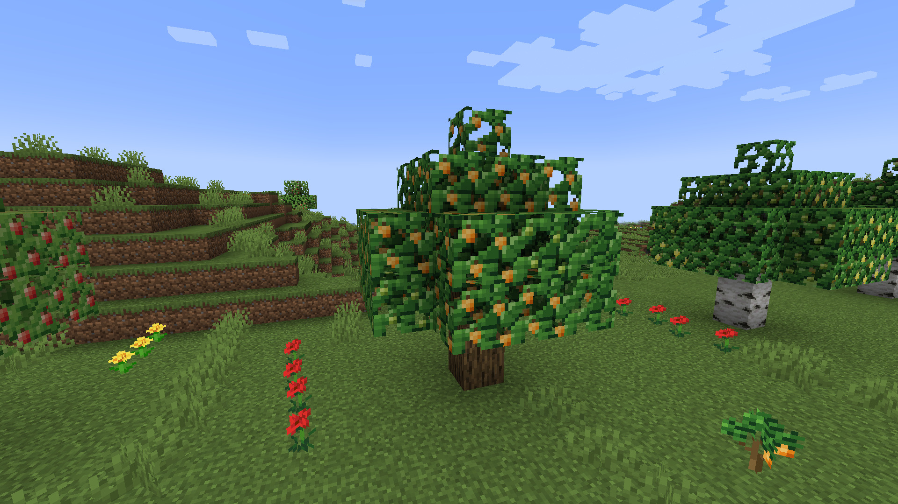

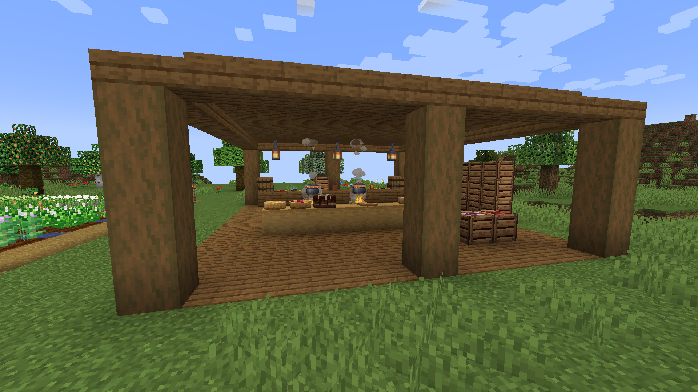

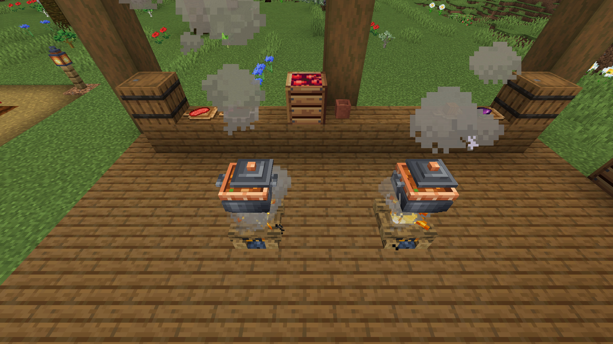

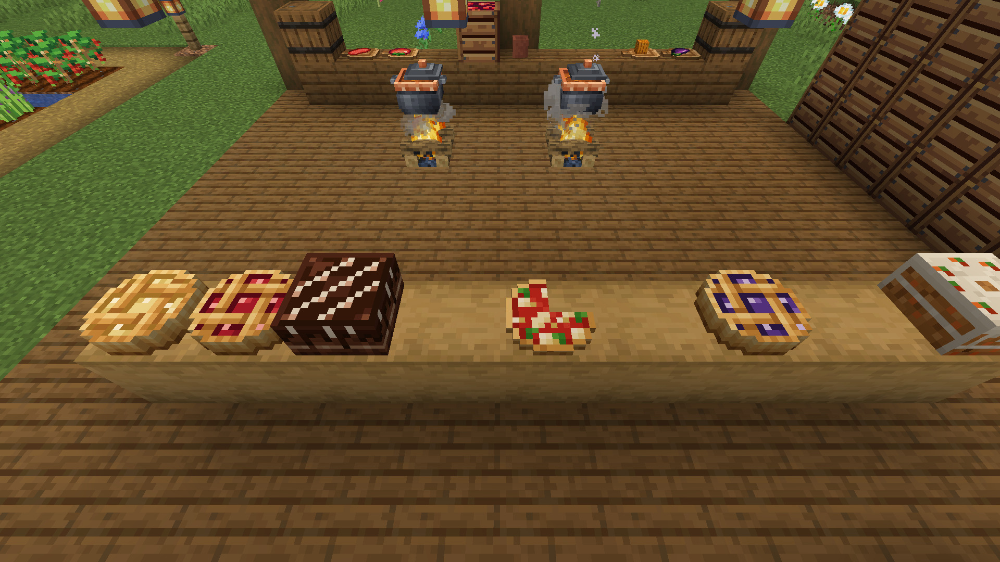

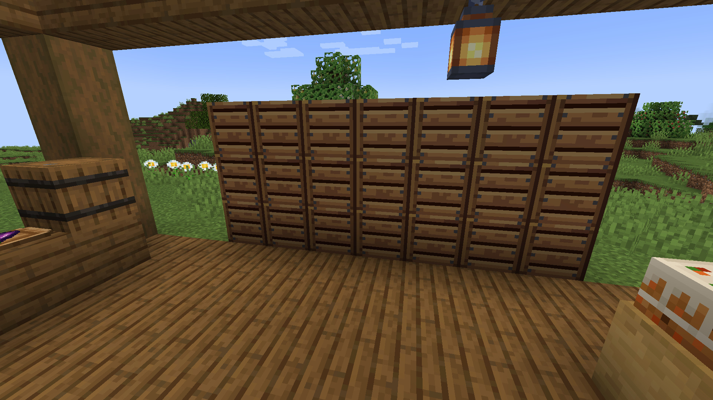

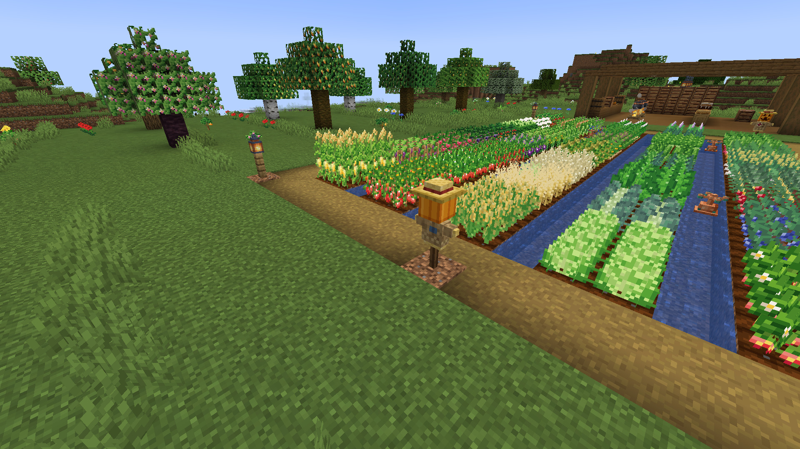

*Screenshots are single unedited frames from Minecraft 1.21.1 (Fabric). The farm, orchard and kitchen were laid out
with commands; the steam, the sprinkler spray, the watering and the cooking pot screen are the mod running.*

[Discord](https://discord.gg/SAmd9fhNhr) · [Source and issues](https://github.com/MeherBenSalem/sprout_and_soil) · [Support us](https://nightbeam.dev/support) · Made by NightBeam Studio
